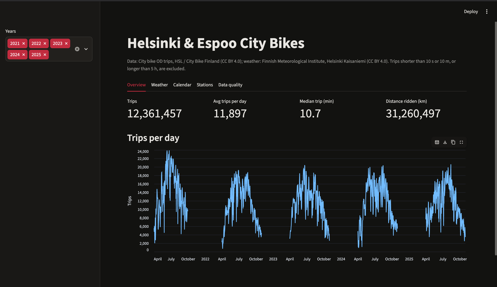
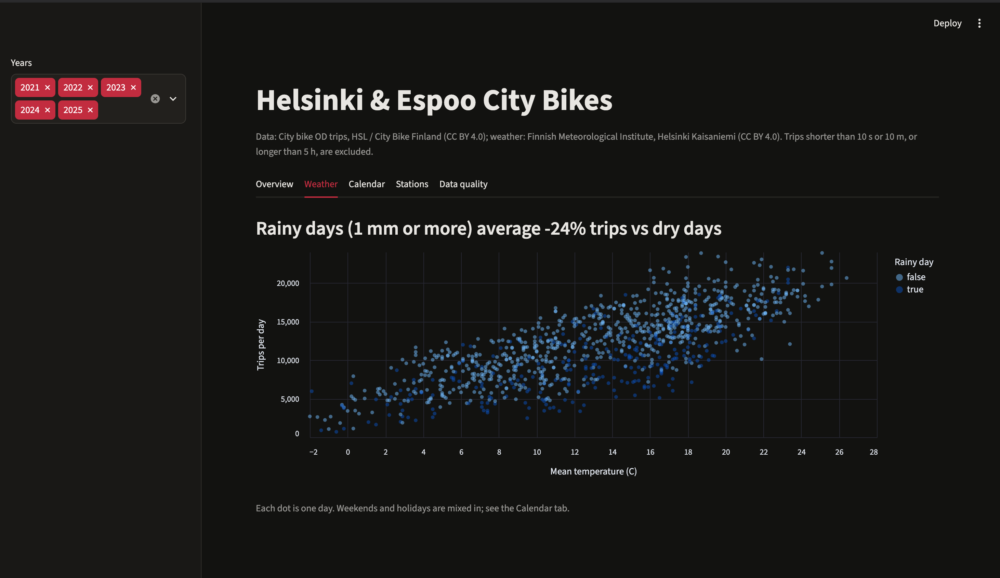
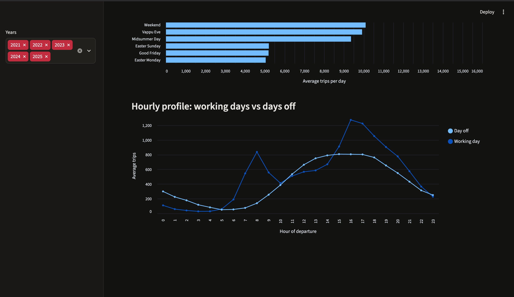
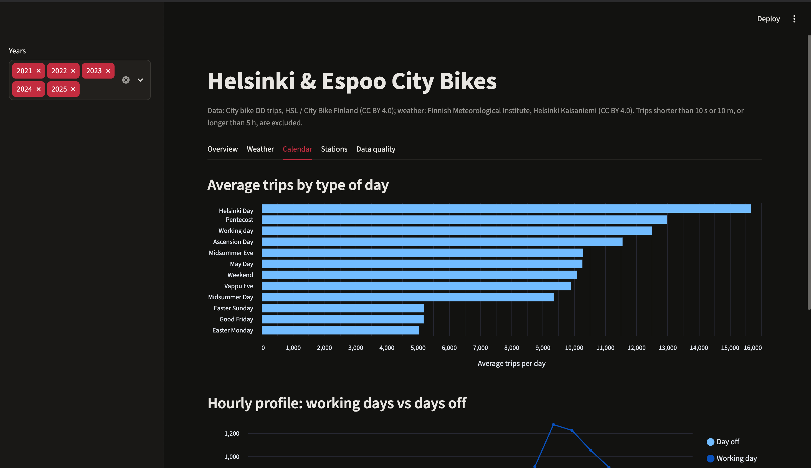
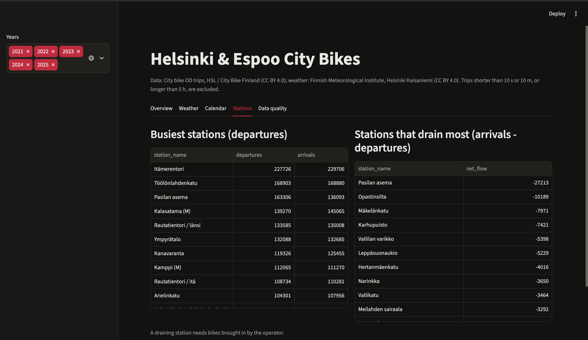
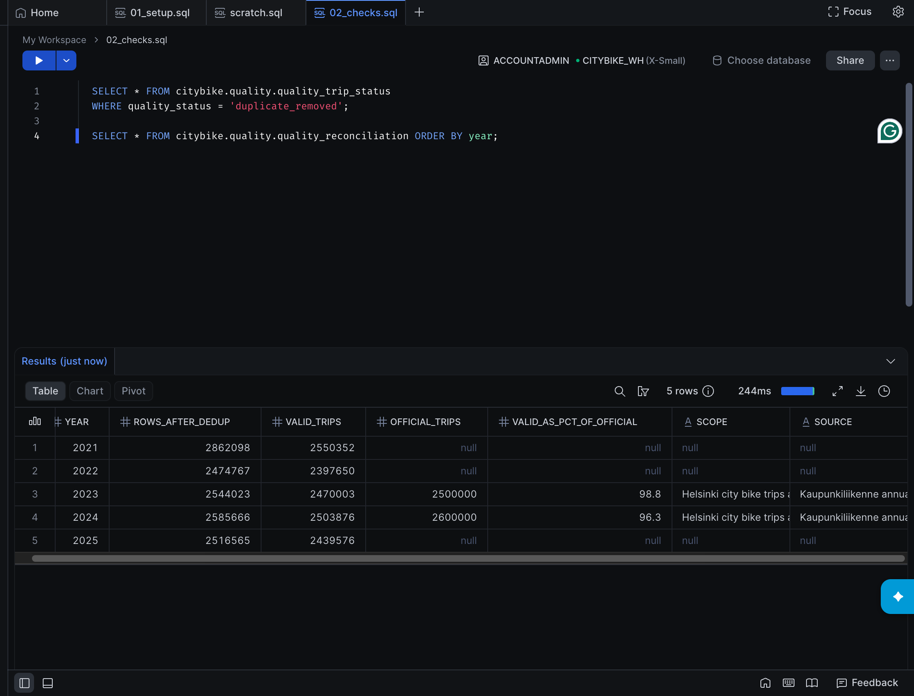

# Helsinki City Bike Pipeline

An end-to-end data engineering project on Helsinki and Espoo city bike trips:
Python ingestion, Snowflake, dbt, automated tests, CI and a Streamlit dashboard.

**Question:** how do weather, holidays and the calendar shape city bike use in Helsinki and Espoo?


## Architecture

```
HSL trip CSVs ─┐                       ┌─ staging (views)  ─┐
               ├─ Python ─ stage ─ COPY INTO ─ raw ─ dbt ──┤                    ├─ Parquet ─ Streamlit
FMI weather ───┘   (normalise)                             └─ marts + quality ──┘
                                                 seeds: calendar, special days, official totals
```

- **Ingestion** (`ingestion/`): downloads monthly trip files and daily weather, normalises
  headers and delimiters, writes fixed-schema `.csv.gz`, then `PUT` + `COPY INTO` Snowflake.
  `COPY INTO` remembers loaded files, so re-running a month does not duplicate rows.
- **Warehouse** (`snowflake/01_setup.sql`): X-Small warehouse with 60 s auto-suspend,
  a 20-credit resource monitor, a least-privilege `TRANSFORMER` role and a key-pair service user.
- **Transformation** (`dbt/`): staging (typing, dedup, quality labels) → marts
  (`fct_trips`, `dim_station`, `dim_date`, daily/hourly/station aggregates) → quality tables.
  24 data tests, including custom generic tests.
- **Portability**: the same dbt project runs on DuckDB (`--target duckdb`), so the project
  keeps working for free after the Snowflake trial.
- **CI** (`.github/workflows/ci.yml`): every push loads synthetic fixtures through the real
  parsers, runs `dbt build` on DuckDB and smoke-tests the dashboard. No secrets needed.
- **Privacy**: only aggregates are exported or published, never trip-level rows.

## Quick start

Python 3.11 to 3.13.

```bash
python -m venv .venv
source .venv/bin/activate            # Windows: .venv\Scripts\activate
pip install -r requirements.txt
python scripts/make_keypair.py       # then run the printed ALTER USER in Snowsight
cp .env.example .env                 # Windows: copy .env.example .env; then fill it in
```

1. Run `snowflake/01_setup.sql` in a Snowsight worksheet (paste your public key first).
2. Load data:
   ```bash
   for y in 2021 2022 2023 2024 2025; do python ingestion/trips.py --year $y; done
   python ingestion/weather.py --start 2021-01-01 --end 2025-12-31
   ```
3. Transform and test: `python scripts/run_dbt.py build`
4. Export and view: `python scripts/export_marts.py` then `streamlit run dashboard/app.py`

Without Snowflake, add `--target duckdb` to steps 2 to 4.

## Data sources

| Data | Source | Licence |
|---|---|---|
| City bike trips (Helsinki + Espoo), 2021-2025 | HSL, City bike stations' Origin-Destination data, owned by City Bike Finland | CC BY 4.0 |
| Daily weather, Helsinki Kaisaniemi (fmisid 100971) | Finnish Meteorological Institute open data | CC BY 4.0 |
| Finnish public holidays | `holidays` Python package | MIT |

Definitions and limitations: [docs/metrics.md](docs/metrics.md).

## Results at a glance

| | |
|---|---|
| Seasons covered | 2021 to 2025, April to October |
| Valid trips after cleaning | 12,561,225 |
| Average trips per day | 11,739 |
| Median trip | 10.6 minutes |
| Busiest day | Tuesday 22 June 2021: 23,893 trips at 25.1 °C |
| Check against official totals | 98.8% (2023) and 96.3% (2024) of the city's published figures |



## Findings

Working days, May to September, unless stated. Each holiday is one day per year, so holiday
figures rest on 4 or 5 days each and should be read as indications, not proofs.

**1. Temperature is the strongest single driver.** Across working days, daily trips rise by
about 640 for every extra degree of mean temperature (correlation 0.81). Days below 5 °C
average about 6,100 trips; days of 20 °C and above average about 18,400.

**2. Rain cuts trips by about a fifth, and more as it gets heavier.** Rainy working days
(1 mm or more) average 22% fewer trips than dry ones. Compared with dry days: under 1 mm is
-9%, 1 to 5 mm is -16%, 5 to 10 mm is -24% and 10 mm or more is -37%. The effect holds within
every temperature band, so it is not just rain falling on cold days.



**3. Working days are busier than days off, and shaped differently.** Working days average
12,515 trips against 9,984 on weekends and holidays. Working days have a commute peak in the
morning and a bigger one around 16:00 to 17:00; days off build to a single afternoon hump.



**4. Holidays mostly empty the system; two special days do the opposite.** Compared with
ordinary days of the same type in the same month: Midsummer Eve (-39%), Good Friday (-38%)
and Easter Monday (-32%) are the quietest. Vappu Eve (30 April) is the exception at +45%,
and Helsinki Day (12 June) runs at a normal level.



**5. Use has been stable since 2022.** Valid trips per season: 2.75M (2021), 2.40M (2022),
2.47M (2023), 2.50M (2024), 2.44M (2025). 2021 is the high point.

**6. Bikes drain out of Pasila and collect in the centre.** Itämerentori is the busiest station
(231,327 departures). Pasilan asema loses the most bikes: 27,624 more departures than
arrivals over five seasons, so the operator has to keep bringing bikes back. Central and
seaside stations such as Unioninkatu, Hernesaarenranta and Kanavaranta gain bikes.



## Data quality

Nothing is silently dropped. Every raw row gets a label in `stg_trips`, and
`quality_trip_status` counts them per file.

| Label | Rows |
|---|---|
| valid | 12,561,225 |
| duplicate_removed | 1,897,685 |
| too_short_distance (< 10 m) | 301,242 |
| too_short_time (< 10 s) | 76,337 |
| too_long (> 5 h) | 37,520 |
| missing_field | 6,724 |
| returned_before_departure | 71 |

Problems found in the published source files:

- **April to July 2021 contain every trip twice.** 1,897,679 exact duplicates, removed in
  staging. Without this step 2021 would look almost twice as busy as other years.
- **October 2021 has an empty duration column.** Duration is derived from the departure and
  return timestamps instead, and flagged with `is_duration_derived`. This recovers 199,768
  valid trips that would otherwise be lost.
- **2025 uses a non-numeric station code, `*40` (Puotila).** It cannot be cast to an integer
  and would clash with station 040 (Hakaniemi), so these trips stay flagged as
  `missing_field` rather than being guessed. About 0.1% of 2025.



## Cost

Built on a Snowflake trial: X-Small warehouse, 60 s auto-suspend and a 20-credit resource
monitor. Loading and modelling the first full season used 0.15 credits.

## Limitations

- Weather comes from one station (Helsinki Kaisaniemi) and is applied to both cities.
- Official totals are published as rounded figures, and only 2023 and 2024 were found, so
  reconciliation is approximate.
- Derived October 2021 durations use local timestamps; trips crossing the daylight saving
  change on 31 October 2021 may be off by an hour.
- Station net flow does not include the operator's own redistribution trips.
- Findings are associations, not causal estimates.

## Next steps

- Incremental model for `fct_trips` and a snapshot of station names (SCD2)
- Station coordinates and city from HSL's station dataset, then a map
- A station-ID mapping so codes like `*40` can be kept instead of excluded
- Helsinki cyclist counter data (year-round) and the "did cycling decline?" question
- Spatial joins: population (Statistics Finland Paavo), universities, metro stations
- Next-day station risk model
- Rebuild the core on Microsoft Fabric
